


 

    

 



I study **Control Engineering (L2 Automatique)** at Abderrahmane Mira University of Béjaïa and I build software that ships. Control theory taught me to think in feedback loops: measure, compare, correct. I apply the same loop to products: start with the simplest system that works, watch where it fails, then add exactly the component that fixes it.

I work across the whole stack, from interfaces in **React, Next.js and TypeScript** to **Node.js** APIs and databases, and I integrate **AI models** where they remove real work: vision OCR, structured generation, agent-driven development workflows. My code has run on a touch kiosk at a national expo, ships as an installable PWA, and is proposed upstream in open-source libraries.

 



 


### ProfScanner

<b>CREATOR</b> &nbsp;/&nbsp; AI &middot; DOCUMENTS &middot; PWA

<a href="https://profscanner.netlify.app">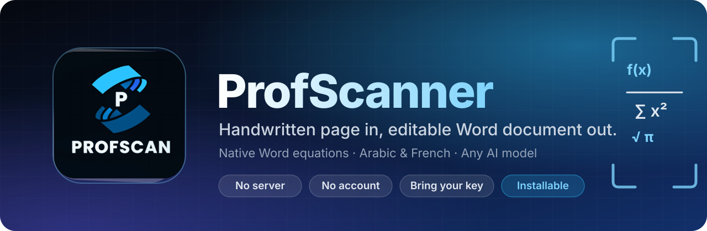</a>

Take a photo of a handwritten exam or exercise sheet and get back a `.docx` you can keep editing, with real, clickable Word equations. A vision model reads the page, a custom generator rebuilds it as OOXML. Arabic, French and English on the same page. Local-first: no server, no account, keys never leave the browser.

**Stack** &nbsp; `React` `TypeScript` `Vite` `Tailwind` `Vision LLMs` `MathML to OMML` `PWA` 
**Links** &nbsp; [Live demo](https://profscanner.netlify.app) &nbsp;&middot;&nbsp; [Repository](https://github.com/simoosh/profscanner) &nbsp;&middot;&nbsp; [Releases](https://github.com/simoosh/profscanner/releases)

 

### ODEJ Kiosk

<b>LEAD DEVELOPER</b> &nbsp;/&nbsp; GEOSPATIAL &middot; KIOSK &middot; BILINGUAL

<a href="https://odej-bejaia.netlify.app">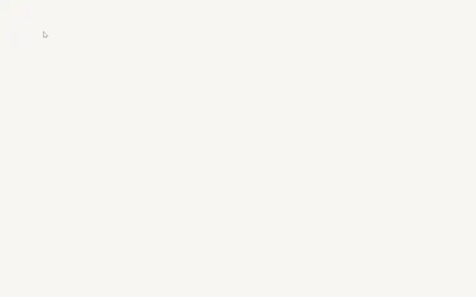</a>

Touch-screen kiosk of the Youth Establishments Office of Béjaïa, run on the stand at the national youth establishments exhibition in Algiers. A 3D map of the wilaya and its 68 establishments, in Arabic and English, portrait and landscape. Self-hosted terrain, progressive fog, a Remotion intro, a media pipeline to a CDN and an offline pack for the kiosk, delivered in eight CI-gated steps.

**Stack** &nbsp; `React 19` `TypeScript` `Vite` `MapLibre GL` `Remotion` `sharp` `Vitest` `GitHub Actions` `Netlify` `Cloudflare Pages` 
**Links** &nbsp; [Live site](https://odej-bejaia.netlify.app) &nbsp;&middot;&nbsp; [Repository](https://github.com/simoosh/ODEJ_KIOSK)

 

### Sadeem

<b>DEVELOPER</b> &nbsp;/&nbsp; GAMIFIED LEARNING &middot; 1ST PLACE NATIONAL

Arabic-first learning platform for ages 5 to 17, built with Adem Mila and awarded first place at a national hackathon. XP, streaks, hearts, leaderboards, six mini-game types, and dedicated spaces for students, teachers, parents and administrators. Answers are validated server-side, the interface is fully right-to-left.

**Stack** &nbsp; `React` `TypeScript` `Vite` `Tailwind` `React Three Fiber` `Node.js` `Express` `MongoDB` `JWT` 
**Links** &nbsp; [Live demo](https://sadeemv1.netlify.app)

 


| Repository | Contribution | Status |
|:--|:--|:--:|
| [**TurboDocx/html-to-docx**](https://github.com/TurboDocx/html-to-docx) | Exports MathML `<math>` elements as native Word equations (OMML) instead of images or raw text. | [In review](https://github.com/TurboDocx/html-to-docx/pull/271) |
| [**RyanTech00/claude-telemetry**](https://github.com/RyanTech00/claude-telemetry) | Tracks the reasoning effort of every request, per model and per machine, across the dashboard. | [In review](https://github.com/RyanTech00/claude-telemetry/pull/6) |
| [**linuxcoding-ADAM/Salat**](https://github.com/linuxcoding-ADAM/Salat) | Rust, Ratatui: prayer times and Adhan for the Linux terminal. Curated city data for the offline search. | [Merged](https://github.com/linuxcoding-ADAM/Salat/pull/2) |
| [**linuxcoding-ADAM/salat-website**](https://github.com/linuxcoding-ADAM/salat-website) | Landing page interactions: font-swap text effects, pixel state, hero layout, navigation hover. | [3 merged](https://github.com/linuxcoding-ADAM/salat-website/pulls?q=is%3Apr+author%3Asimoosh) |

 



Every component has a reason to exist and a price to pay. I reason about systems the way they grow in production:

| Symptom | Component | What it costs |
|:--|:--|:--|
| One server saturates on CPU and RAM | **Horizontal scaling** behind a **load balancer** with health checks | Servers must be stateless, sessions move to a shared store |
| The database becomes the bottleneck | **In-memory cache** for hot, read-heavy data | Cache invalidation, stale reads, warm-up |
| A machine dies and takes the data with it | **Replication** and **backups**, no single point of failure | Replica lag, failover logic, restore drills |
| Static media slows every page | **CDN** in front of object storage (as on ODEJ Kiosk) | Cache busting, versioned asset URLs |

 


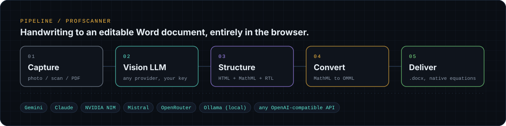

- **Model-agnostic integration.** One adapter layer over OpenAI-compatible APIs: switch between Gemini, Claude, NVIDIA NIM, Mistral, OpenRouter or a local Ollama without touching the product.
- **Structured output you can trust.** Prompts that return constrained HTML and MathML, then deterministic code that validates and converts them. The model reads, the code decides.
- **Agentic development workflows.** Repositories set up for AI agents: written conventions, isolated worktrees per task, step-by-step pull requests gated by CI and human review.
- **Automation where it pays.** From a Python file-watcher that auto-saves AutoCAD 2007 drawings to media pipelines that optimize images and publish them to a CDN.

 


 

 


 


| Project | What it is | Stack |
|:--|:--|:--|
| **Wladz** | Hub of educational games for Algerian children aged 7 to 15: prevention, civics, history of the 58 wilayas, a story-driven open world. Built for the Ministry of Youth. | Next.js, Three.js, GSAP, SQLite, Tailwind |
| **Maghamer** | Educational game platform on Algerian history and civic values: missions, quizzes, rewards, 9 server-validated mini-game types. Hackathon build. | React, Vite, Express, MongoDB, MySQL, JWT |
| **Forsati** | Connects Algerian youth to youth establishments: recommendations, event registration, QR ticketing. Team build at ECOHACK26. | Next.js, Firebase, QR codes |
| **Boutique Rayane** | E-commerce front with a product customizer on canvas and image compression in the browser. | React, Fabric.js, Firebase, Zustand, Zod |
| **Salat landing** | Animated landing page for the Salat terminal app, pixel and mono typography. | React, Vite, TypeScript |
| **AutoCAD auto-save** | Python watchdog plus AutoLISP `SAVETIME` so drawings are never lost on legacy Windows 7 machines. | Python, AutoLISP |
| **Annuaire Étudiants** | Benchmarks of data structures for a student directory, with plotted results. | C, Python, Gnuplot, Make |

**Hackathons:** National Hackathon for Innovation and Digital Design, Mostaganem (**1st place**, Sadeem, with Adem Mila) &nbsp;/&nbsp; Hackathon Akbou &nbsp;/&nbsp; EcoHack, Chellata.

**Frequent collaborator:** [Adem Mila](https://github.com/linuxcoding-ADAM), on Salat, its website and several hackathon teams.

 

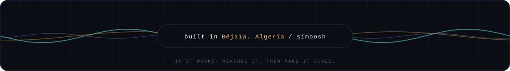
